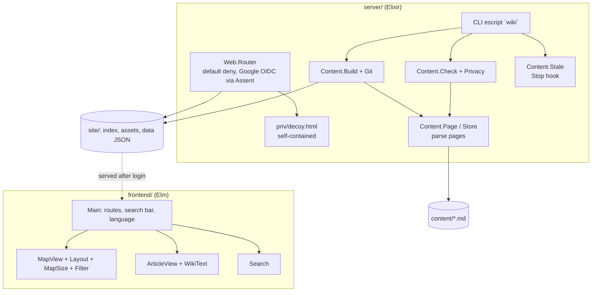

# Wiki: design and development decisions

What the system is, how it is built and why. Living document: updated in the same commit as the change.
The approved design and build plan of 2026-10-22 are in `docs/2026-10-22-wiki-design.md`.

Last updated: 2026-10-25

## 1. What it is

A private wiki of everything in Giovanni's systems (projects, programs, modules, functions, skills, hooks,
services, data, actors, processes), so Giovanni can answer an architecture question from Claude after one search
and at most two clicks. Home is a Dark-style map; hovering a dot fills four boxes (what it is, what it does, fed by,
who receives its output); clicking opens a Wikipedia-style article with an infobox, a pipeline strip and a small
graph of connected pages. Interface and pages in English, German and Brazilian Portuguese. Claude keeps it current
at the end of every task (`wiki publish`, then `mem use`).

## 2. Architecture

### System context (C4 level 1)

### Containers and modules (C4 level 2)

Dependency direction: the content modules know nothing about the web; the router only serves files. The front end
only reads `data/*.json`. What enforces it: the router tests serve fixtures, the content tests run on temporary
folders, and the Elm app makes no request outside `/data`.

## 3. Testing

`docs/REQUIREMENTS.md` (AU, DC, CO, LG, BU, UP, MP) with tagged tests in `server/test` (ExUnit) and
`frontend/tests` (elm-test); `tools/quality_gate.sh` also runs `wiki check` on the real content and the fitness
functions (gzipped bundle size, gate time).

## 4. Decision log

Newest first. **Type** is the ISO/IEC/IEEE 14764 maintenance category: *corrective*, *adaptive*, *perfective*,
*preventive* or *initial*.

| Date | Type | Decision | Why |
|---|---|---|---|
| 2026-10-25 | Corrective | **Phone map made fast and usable on the real phone** (MB-6..MB-8). Tested on Giovanni's phone (Chrome over `adb reverse`, Chrome DevTools frame timing): after a tap each frame took 118 ms, because 150 dots and 350 lines each had a CSS fade and the map redrew in window coordinates at every pan event. On a phone there are now no transitions and no dashes, the dots sit in one group moved by the browser and redrawn through `Svg.Lazy` only when something but the pan changes (`MapView.flatLayer`), giving 17-19 ms frames for tap, pan and pinch. Also: the page is `translate="no"` (Chrome's translation popup covered the search bar), choosing a search result blurs the field so the keyboard does not cover the balloon, and a height-only resize (keyboard, address bar) no longer refits the map | Giovanni: the phone version did not work at all; it had only been checked in a desktop browser narrowed to phone width, which cannot show a phone's speed |
| 2026-10-25 | Perfective | **A living map: elastic dots and a lens** (LN-1..LN-3, DY-1..DY-4). The map was a frozen snapshot: positions were computed once and a resize only stretched them. Now each dot has a small displacement on top of its resting place (`Motion`: a spring back to the place, a spring towards the average of its neighbours, friction); dragging a dot stretches its neighbours along and they contract when it is released, hovering draws the neighbours a fifth of the way in, the first load springs open from the middle and a resize springs from the old screen positions to the new places. Animation frames are only requested while something moves. On a desktop the map is drawn through a fisheye lens (`Lens`, strength 1.2, centred in the free area): the middle is magnified (dots up to 1.6 times bigger, labelled), the border squeezed (smaller, no labels, no dashed lines), nothing leaves the window; off on phones. Dots are now placed in window coordinates (zoom, then lens) instead of under one scaled group | Giovanni: the web map felt like a static image, the nodes did not stretch and contract, and responsiveness was poor; wanted a lens-like perspective with bigger, more spread dots in the middle and smaller, less detailed ones at the border. The elastic layer is added on top of the layout rather than a live force simulation so that the layout and MP-6 stay as they were |
| 2026-10-25 | Perfective | **Phone version and uncut step circles** (MB-1..MB-5). At 760 px or less the map fills the whole screen (`MapSize.isPhone`), the top bar becomes a Google-Maps-style search pill with the menu (map, glossary, language, log out) inside it and a chip row of filters under it; a tap on a node opens a balloon (`MapView.sheet`: what it is, what it does, neighbours as buttons, link to the page) instead of leaving the map, and hover is ignored there. Article pages follow the Wikipedia mobile site: title, lead, infobox, then sections that start closed and open on a tap. On every width the box around the step circles of a process page now has padding, because `overflow-x: auto` also clips vertically and cut the lit circle's glow and growth | Giovanni: circles of the steps on `/p/new-project` were cut off by their box; wanted a phone version modelled on Google Maps (whole-screen map, search on top, balloons) and Wikipedia mobile for articles. Tested in headless Chrome with touch emulation (tap, close, menu, section toggle) |
| 2026-10-25 | Preventive | **Monthly architecture review**: pipeline-check v0.4.0, local mode, report of 2026-10-25: 0 falhas, 0 avisos, 1 pulado (protecao-de-branch); 1 proposal, plus wiki#1 closed (shellcheck now runs in the gate); proposals created as pipeline-check#4 | Monthly review standard (ADR-0013): the program measures, the skill judges |
| 2026-10-24 | Corrective | **The page records its review time; `wiki stale` compares sources with it** ([ADR-0006](docs/adr/0006-review-time-in-the-page.md); CO-6, ST-1..ST-3, UP-3). `reviewed` is now required on every page (UTC date or date and minute, not in the future); `wiki stale` lists a page when a source changed after it, counts sources outside git by modification time, prints the source and both times, and exits 1 when it lists a page. The Stop hook message asks Claude to set `reviewed` on a page it checked. | `wiki stale` compared source commit time with the page file's own commit time, so the 154-page rewrite of 2026-10-24 hid every change before it (38 of 140 pages with sources, all 34 pages with sources outside git were invisible), and the function had no requirement or test |
| 2026-10-24 | Perfective | **Pages written for a newcomer** (CO-8, CO-9, BU-3, MP-8, MP-9). All 153 pages were rewritten so that a reader with no knowledge of the system or of its technical language can follow them: plain definitions where a term first appears, links to outside explanations for complex terms, a new `glossary` page (kind `reference`, linked from the top bar), and each skill page now carries the skill's own definition in its Steps section. Four things enforce it: `wiki check` requires a Steps section on every page of kind skill, and requires the full name of every acronym listed in `content/_acronyms.tsv` at its first use on an English page (code quotes and link addresses are skipped); a page of kind `reference` draws no edges on the map; links to other sites open in a new tab | Giovanni: the pages explained everything but were hard to understand; each page must help someone with no previous knowledge, acronyms need their full name at first use, complex terms need a link, skill pages need the skill's definition. The rules that can be checked by a program are checked, the rest (plain wording) is a writing rule in CLAUDE.md |
| 2026-10-24 | Corrective | **First maintenance review: bug-finding tests for the privacy scan and three fixes** (`docs/TESTES-AUTOMATIZADOS.md`, `server/test/privacy_test.exs`): GitHub fine-grained, GitLab and Google API tokens, Brazilian and other phone shapes, and CPF numbers are now blocked before publishing | CO-4 promises that keys, tokens, passwords and phone numbers are blocked; the patterns had never been checked against that rule, and the same boundary in workflow-memory had the same gaps (two copies of one rule: debt) |
| 2026-10-24 | Preventive | **One list of privacy patterns** instead of two: `mem/privacy-patterns.tsv` in workflow-memory is the source, `server/priv/privacy-patterns.tsv` its copy, compared by the gate on the laptop (debt issue workflow-memory#3) | The two lists had already drifted (the wiki lacked bearer tokens; memory lacked Telegram, Google client secrets and `password: value`). The union is stricter in both. A copy remains because the private repositories cannot see each other in CI; the comparison makes drift fail instead of go unnoticed |
| 2026-10-24 | Preventive | **`pipeline-check` moved to its own repository** (`yujideluca/pipeline-check`, ADR-0003 there) and consumed by pinned version: this project keeps `pipeline-check.toml`, `pipeline-check.version`, the small runner `tools/pipeline-check.sh` and a local pre-push check (`tools/hooks/pre-push`, enable with `git config core.hooksPath tools/hooks`; it stands in for branch protection on a private free-plan repository). The program's requirements PC-* and tests live there | One fix there, one tag, instead of N copies. Rule: a tool used by more than one project lives once and is consumed by version |
| 2026-10-24 | Preventive | **`tools/pipeline-check` adopted** ([ADR-0005](docs/adr/0005-program-measures-skill-judges.md)): the Rust program that measures and blocks (copied from the project template) runs the gate once in CI and writes `report.json`; limits in `pipeline-check.toml` (largest Elixir/Elm file, gate time); the existing gzip size limit of `app.js` stays in the gate | The gate held only because Claude ran it; now a `falha` fails the CI job. The monthly review (skill `revisao-manutencao`) reads the report |
| 2026-10-22 | Perfective | **Bigger map, quicker highlight, roomier layout** (MP-5..MP-7). On a wide, tall enough window (above 1100 px) the map takes all the height the four info boxes do not need: `MapSize` gives the boxes a fixed height from their text width (about 226 px at 1920 px, a longer text scrolls inside its box) and the map the rest, so the page fits the window and never scrolls on hover; on a shorter or narrower window nothing changes (58 % share, boxes size themselves), so the map is never smaller than before (1920x943: 623 px instead of 547). The layout is reshaped to the map area (`Layout.matchAspect`, stretch only, capped at 3) after a force simulation that settles wide and flat (a pull to a horizontal line, stronger repulsion, a collision radius), and the graph is centred below the floating controls (`MapSize.insets`). Every fade on the map lasts 0.07 s (was 0.25 s) and each dot has an invisible larger hit area. Measured on the 149 pages at 1920x943: median gap between dots 48 px (was 23), closest pair 31 px (was 10), pairs closer than 20 px none (was 37) | Giovanni: the map window should use the free screen, leaving only room for the boxes; dots lit up too slowly; dots were too close together. Elm's own work per hover is about 12 ms, so the delay was the CSS fades. Scaling a layout to fit changes nothing on screen, so spacing had to come from the layout's shape and the collision radius, not from bigger distances |
| 2026-10-22 | Corrective | Map zoom and pan: the SVG declares a `viewBox` equal to its size, and on the map the top bar floats over it so the map starts at the window's top-left | Without a viewBox Chrome reports an empty one and elm-visualization turned every pointer position into (0,0): wheel zoom anchored at the corner and drag did not pan (Giovanni's report). Touch positions are measured from the window, wheel positions from the map; with the map at (0,0) they agree |
| 2026-10-22 | Corrective | Google's certificate is checked with OTP's system trust store (`:public_key.cacerts_get()`) plus `ssl_verify_fun` for the host name | Assent refused an unverified HTTPS call to Google; certifi would add a second, separately updated CA list |
| 2026-10-22 | Perfective | Map labels: only projects, the hovered dot and its neighbours until zoomed in; label size compensates zoom. Timeline stops are days, not months | With 145 pages the full-map labels piled up; all pages so far appeared in the same month |
| 2026-10-22 | Perfective | Articles follow the system colour scheme (light Wikipedia paper, warm dark paper when the system is dark); pages declare `color-scheme` | Chrome's forced dark mode was inverting the light article into unreadable colours |
| 2026-10-22 | Initial | Content as Markdown + header, `[[id]]` links, `fed_by`/`feeds` edges, `repo:path` sources, translations with a source hash (ADR-0004) | Claude can write and check plain files; the format is independent of the site's code |
| 2026-10-22 | Initial | One Elixir app for login, decoy and files; Google OIDC via Assent; Tailscale Funnel for the address (ADR-0003) | Giovanni chose Elixir, Google login for one account, and Funnel over buying a domain |
| 2026-10-22 | Initial | Elm front end, Elixir back end (ADR-0002) | Giovanni's choice of languages |
| 2026-10-22 | Initial | Project started from `~/dev/project-template` | Golden path: ADRs, requirements, gate and CI from day one |

## 5. Known limitations

Tracked as GitHub Issues labelled `debt` (see `docs/MAINTENANCE.md`). At the start:
- The site is online only while the laptop is on and awake.
- The Stop hook sees committed changes only; uncommitted work is caught at the next commit.
- Off-laptop pages (Claude app, Google Doc) cannot be checked against their source; their review time is the only guard (30 days).
- Staleness is by time: a source change after the review time lists the page even when the change does not touch what the page says, and a change in the same minute as the review is not seen. A review time set without a real comparison defeats the check; the skill `wiki-page-writer` forbids it.
