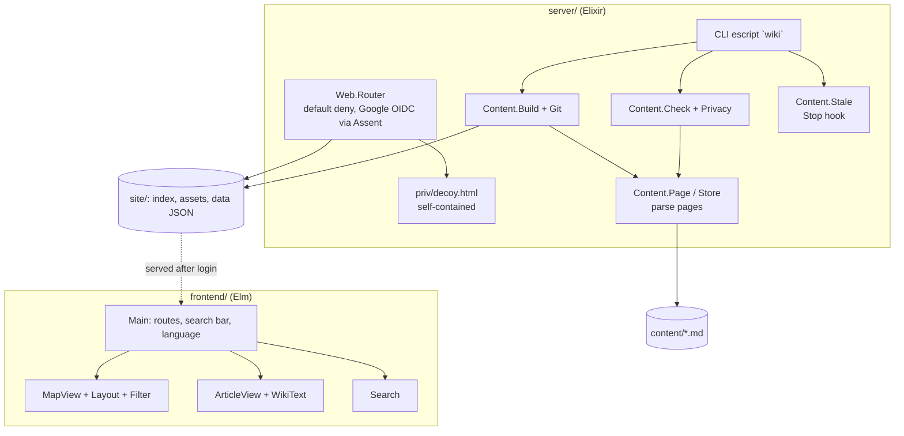

# Wiki: design and development decisions

What the system is, how it is built and why. Living document: updated in the same commit as the change.
The approved design and build plan of 2026-10-22 are in `docs/2026-10-22-wiki-design.md`.

Last updated: 2026-10-22

## 1. What it is

A private wiki of everything in Giovanni's systems (projects, programs, modules, functions, skills, hooks,
services, data, actors, processes), so Giovanni can answer an architecture question from Claude after one search
and at most two clicks. Home is a Dark-style map; hovering a dot fills four boxes (what it is, what it does, fed by,
who receives its output); clicking opens a Wikipedia-style article with an infobox, a pipeline strip and a small
graph of connected pages. Interface and pages in English, German and Brazilian Portuguese. Claude keeps it current
at the end of every task (`wiki publish`, then `mem use`).

## 2. Architecture

### System context (C4 level 1)

### Containers and modules (C4 level 2)

Dependency direction: the content modules know nothing about the web; the router only serves files. The front end
only reads `data/*.json`. What enforces it: the router tests serve fixtures, the content tests run on temporary
folders, and the Elm app makes no request outside `/data`.

## 3. Testing

`docs/REQUIREMENTS.md` (AU, DC, CO, LG, BU, UP, MP) with tagged tests in `server/test` (ExUnit) and
`frontend/tests` (elm-test); `tools/quality_gate.sh` also runs `wiki check` on the real content and the fitness
functions (gzipped bundle size, gate time).

## 4. Decision log

Newest first. **Type** is the ISO/IEC/IEEE 14764 maintenance category: *corrective*, *adaptive*, *perfective*,
*preventive* or *initial*.

| Date | Type | Decision | Why |
|---|---|---|---|
| 2026-10-22 | Corrective | Map zoom and pan: the SVG declares a `viewBox` equal to its size, and on the map the top bar floats over it so the map starts at the window's top-left | Without a viewBox Chrome reports an empty one and elm-visualization turned every pointer position into (0,0): wheel zoom anchored at the corner and drag did not pan (Giovanni's report). Touch positions are measured from the window, wheel positions from the map; with the map at (0,0) they agree |
| 2026-10-22 | Corrective | Google's certificate is checked with OTP's system trust store (`:public_key.cacerts_get()`) plus `ssl_verify_fun` for the host name | Assent refused an unverified HTTPS call to Google; certifi would add a second, separately updated CA list |
| 2026-10-22 | Perfective | Map labels: only projects, the hovered dot and its neighbours until zoomed in; label size compensates zoom. Timeline stops are days, not months | With 145 pages the full-map labels piled up; all pages so far appeared in the same month |
| 2026-10-22 | Perfective | Articles follow the system colour scheme (light Wikipedia paper, warm dark paper when the system is dark); pages declare `color-scheme` | Chrome's forced dark mode was inverting the light article into unreadable colours |
| 2026-10-22 | Initial | Content as Markdown + header, `[[id]]` links, `fed_by`/`feeds` edges, `repo:path` sources, translations with a source hash (ADR-0004) | Claude can write and check plain files; the format is independent of the site's code |
| 2026-10-22 | Initial | One Elixir app for login, decoy and files; Google OIDC via Assent; Tailscale Funnel for the address (ADR-0003) | Giovanni chose Elixir, Google login for one account, and Funnel over buying a domain |
| 2026-10-22 | Initial | Elm front end, Elixir back end (ADR-0002) | Giovanni's choice of languages |
| 2026-10-22 | Initial | Project started from `~/dev/project-template` | Golden path: ADRs, requirements, gate and CI from day one |

## 5. Known limitations

Tracked as GitHub Issues labelled `debt` (see `docs/MAINTENANCE.md`). At the start:
- The site is online only while the laptop is on and awake.
- The Stop hook sees committed changes only; uncommitted work is caught at the next commit.
- Off-laptop pages (Claude app, Google Doc) cannot be checked against their source; they carry a review date.
