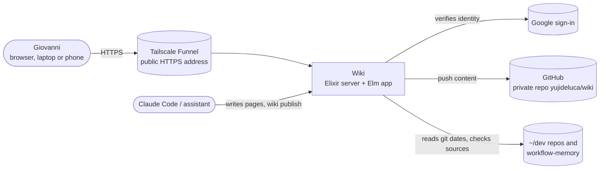
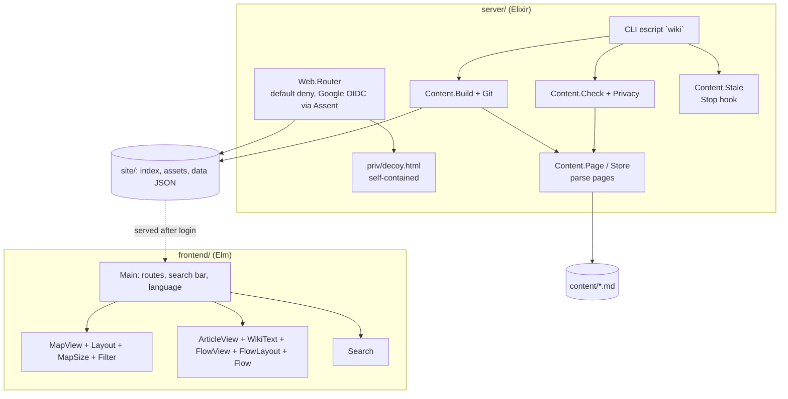

# Wiki: design and development decisions

What the system is, how it is built and why. Living document: updated in the same commit as the change.
The approved design and build plan of 2026-10-22 are in `docs/2026-10-22-wiki-design.md`.

Last updated: 2026-10-27

## 1. What it is

A private wiki of everything in Giovanni's systems (projects, programs, modules, functions, skills, hooks,
services, data, actors, processes), so Giovanni can answer an architecture question from Claude after one search
and at most two clicks. Home is a Dark-style map; hovering a dot fills four boxes (what it is, what it does, fed by,
who receives its output); clicking opens a Wikipedia-style article with an infobox, a pipeline strip and a small
graph of connected pages. Interface and pages in English, German and Brazilian Portuguese. Claude keeps it current
at the end of every task (`wiki publish`, then `mem use`).

## 2. Architecture

### System context (C4 level 1)

### Containers and modules (C4 level 2)

Dependency direction: the content modules know nothing about the web; the router only serves files. The front end
only reads `data/*.json`. What enforces it: the router tests serve fixtures, the content tests run on temporary
folders, and the Elm app makes no request outside `/data`.

## 3. Testing

`docs/REQUIREMENTS.md` (AU, DC, CO, FL, LG, BU, UP, MP) with tagged tests in `server/test` (ExUnit) and
`frontend/tests` (elm-test); `tools/quality_gate.sh` also runs `wiki check` on the real content and the fitness
functions (gzipped bundle size, gate time).

## 4. Decision log

Newest first. **Type** is the ISO/IEC/IEEE 14764 maintenance category: *corrective*, *adaptive*, *perfective*,
*preventive* or *initial*.

| Date | Type | Decision | Why |
|---|---|---|---|
| 2026-10-27 | Perfective | **Diagram size floors, measured on the phone** (FL-3, PJ-3). On Giovanni's Motorola edge 50 fusion (1080x2400 px, 432 CSS px wide, density 2.5) a chart no longer keeps its natural width: it shrinks to at most 60 % of it (80 % on desktop) and scrolls sideways below that, so the five charts up to 700 px wide now fit the 383 px column and a 1184 px one shows at 60 %. The size is set with a CSS variable `--nat` written by `FlowView` instead of an inline `min-width`. A wide diagram still starts at its left edge; centring it would need script outside Elm, so it was not added | Giovanni: check the dimensions on the computer and on the phone left connected for testing |
| 2026-10-27 | Perfective | **Programs show the C4 diagrams too** (PJ-4). The `## Architecture` section is now required for every page of kind `program` as well, not only for projects in a repository; the practices section stays project-only because a program has no golden-path folder of its own. Written for the twelve programs (pipeline-check, mem, the wiki's server, front end and command, codex-skillsctl, the Android toolchain, the two Processing sketches, pbar, tg-send and the user-space tools) in three languages | Giovanni: add the same diagrams to pipeline-check and the other programs, and make the diagrams a rule for the pages in the categories where they were applied |
| 2026-10-27 | Perfective | **Project pages carry a C4 diagram and the project-template practices** (PJ-1..PJ-3). A page of kind `project` that lives in a repository (not a `home:` folder) now has `## Architecture` (two diagrams under `### Context` and `### Containers`, written in the flow's line format with the box words `person`, `system`, `container`, `store`, `external`; `Wiki.Content.Architecture` checks them, `Flow.parseLevels`, `FlowLayout` and `FlowView.viewArchitecture` draw them, without Mermaid) and `## Engineering practices` (six parts in the order of project-template: Principles, Decisions, Requirements, Quality gate, Continuous integration, Maintenance; `Wiki.Content.Practices`). Translations keep the boxes, links, arrows and the number of parts. Written for the nine software projects in three languages from their own design files, gates and workflows | Giovanni: the project pages should contain the C4-style diagram and the other data structured in project-template. Mermaid would need a JavaScript library, so the diagrams reuse our own flow code |
| 2026-10-27 | Perfective | **Article pages use the desktop width; a `system-overview` page** (FL-3). The article column was capped at 1040 px and centred, leaving much of a 1920 px screen empty; it is now `min(1500px, 96vw)`, with paragraphs and list items capped at 125 characters per line so the text stays readable beside the wider flow chart. New page `system-overview` (kind `reference`, so it draws no lines on the map) shows the whole system as one flow chart, linked from the `wiki` page | Giovanni: make the overview page; the article pages left a lot of unused lateral space on the desktop |
| 2026-10-27 | Perfective | **A `## Flow` section drawn as a flowchart** ([ADR-0007](docs/adr/0007-flow-chart-section.md); FL-1..FL-4). Pages of kind actor, project, process and skill now carry a flowchart of how the concept is started, what it engages and what it produces: one line per box (`trigger`, `step`, `decide`, `product`) and one per arrow, parsed by `Wiki.Content.Flow` (checks: a trigger and a product, everything reachable, labelled decisions, no loops, links exist, size limits; translations keep the same boxes and arrows) and by `Flow.elm` (reading) and `FlowLayout.elm`, which lays the boxes out top to bottom (longest-path rows, stopovers for arrows that skip rows, barycenter ordering, an isotonic regression for the columns) and `FlowView.elm`, which draws SVG (pill, diamond, double box; colour by the kind of the first linked page; arrows with `Shape.bumpYCurve`). All 50 such pages and a new `codex` page got a flow in three languages. `index.html` also got `darkreader-lock` because the Dark Reader extension inverted the chart's fills | Giovanni: the big concept pages need a top-to-bottom flowchart with decisions of the chain of events that engages them, what they engage and what they produce; use only elm-visualization, because dagre may break later. elm-visualization 2.4.3 has no layered graph layout, so the placing is our own pure module and only the arrow curves come from the library |
| 2026-10-26 | Corrective | **`wiki --help` and unknown options no longer run the command** (UP-5). `OptionParser` with `strict:` drops an unknown switch silently, so `wiki publish --help` ran a real publish, and a typo such as `--co-autor` would have published without the co-author line. `Wiki.CLI.exec/1` now handles `--help`, `-h` and `help` (usage, exit 0) and any invalid option (usage on stderr, exit 2) before dispatching | Giovanni: fix the --help handling (found while testing UP-4) |
| 2026-10-26 | Corrective | **`wiki publish` no longer writes a fixed `Co-Authored-By: Claude Opus 5.5` line; the publishing session supplies its own** (UP-4). The tool appended that name to every publish commit since 2026-10-22, so commits made by Codex, Sonnet or Giovanni claimed Opus as co-author. Now `--co-author "Name <email>"` or `WIKI_CO_AUTHOR` gives the line; with neither there is no trailer; a value that is not one `Name <email>` line is refused (no extra trailers can be injected). The tool cannot detect the model itself (Claude Code does not export it), so each session passes the attribution line it was given; this is written in CLAUDE.md and in the Stop-hook message | Giovanni: the trailer must follow the committing session, not name Claude Opus |
| 2026-10-25 | Perfective | **Ball fits exactly at first, grows with the zoom up to 30 % cut off, then only the dots spread** (LN-5; replaces the fixed 10 % of the previous row). `fit` now sizes the ball to the free area exactly (radius = half the narrower side) and remembers the zoom scale it chose in `Model.fitScale`. `MapCamera.lensFor` multiplies the radius by `growth (scale / fitScale)` = that ratio clamped between 1 and `maxGrowth` = 1/cos 0.945 = 1.71, the size at which two edge caps of 15 % each (cap of angle t has the share (t - sin t cos t)/π) are cut off; so the first part of the zoom enlarges the whole picture (dots stay in the same place on the ball) and beyond it the ball is fixed and the map scale alone grows. Zooming out leaves the ball at the exact fit. Measured in Chrome at 1920 px: ball height 238 → 406 px while the zoom goes 0.27 → 0.46, then constant | Giovanni: make it up to 30 % of the ball area; start with the ball fitting exactly, first part of the zoom up to 30 %, then only increase the nodes |
| 2026-10-25 | Perfective | **The ball is as big as the screen allows, up to a tenth cut off** (LN-5). The ball's radius was half the narrower side; it is now `MapCamera.ballRadius` = 0.62 × the narrower side of the free area, which leaves two caps of 5 % of the ball's area each beyond the edges (tested by counting cells). On the phone the ball is wider than the screen; on the desktop it is taller than the map area and tucks under the top bar and the legend. `globeFit` still puts the farthest dot at 0.94 of the rim, so a few dots start in the cut-off caps and come into view when panning. Checked in Chrome on the desktop and in a 390 px frame | Giovanni: the ball should fit as much of the screen as possible, with up to 10 % of the sphere allowed out of view |
| 2026-10-25 | Perfective | **A round, more spherical globe, on the phone too** (LN-1, LN-5; LN-4 removed). The first globe was a wide oval and the dot cloud a wide flat band, so it still read as a map. The lens is now a circle (radius = half of the smaller side of the free area, centred in it) with a stronger turn (φ = 1.2 rad: middle 1.3 times, rim 0.4, about 3 times tighter) on desktop and phone alike; the phone's rectangular lens (`Shape.Rectangle`, `Shape` itself) was deleted. `MapCamera.globeFit` reshapes the layout to aspect 1 (`Layout.matchAspect 1`), bends its square into a disc (each point keeps its direction; its distance as a share of the square it lies on becomes a share of the disc) and zooms so the farthest dot sits at 0.94 of the rim; a dot beyond the rim (`Spot.r > 1.03`) is on the far side and is not drawn; graticule and shading now show on the phone too. While a dot is selected on the phone the circle shrinks into the part above the balloon. Checked in Chrome on the desktop and in a 390 px frame (phone layout); not yet on Giovanni's phone (frame times unmeasured, MB-6) | Giovanni: the effect was too map-like; make it more spherical and make the dot cloud more equilateral to fit that, on the phone too |
| 2026-10-25 | Perfective | **The lens is a globe, not a fisheye** (LN-1, LN-4). The fisheye (strength 1.2) magnified the middle 2.2 times and squeezed the border to 0.45 and the corners to 0.3, so the rest of the map was crammed against the rim. `Lens` now wraps the area onto a sphere seen from the front: a point at distance r (1 on the ellipse touching the sides) lands at sin(r·φ)/sin φ, with φ = 0.8 rad on the desktop (middle 1.1 times, sides 0.8, corners 0.5) and φ = 0.9 per axis on the phone's rectangle; beyond 1.2 rad the curve continues as a straight slope so far-away points never fold back. Each `Spot` also carries `squash` and `tilt` (the singular values of the lens's Jacobian), and dots are drawn as ovals flattened along the turn; the desktop draws a faint sphere shading and curved latitude/longitude lines behind the dots (`MapView.globe`). `Shape.Ellipse` became `Shape.Globe`; label and dashed-line thresholds were retuned (`k·scale² ≥ 0.7`, `scale < 0.86`). Checked on the desktop in Chrome; the phone width could not be checked (the browser window did not shrink), only by unit tests | Giovanni: change the zoom effect to a globe-like, three-dimensional effect, redistributing the zoom so the rest is not crammed onto the borders |
| 2026-10-25 | Corrective | **Touch: no accidental zoom** (TC-1..TC-3). Giovanni: the map zooms while a finger moves around the screen. Reproduced on the phone (Chrome DevTools touch events, `data-zoom` read from the map): quick light taps zoomed in because the zoom library turns two quick single touches into a double-tap zoom, and the library keeps a memory of which fingers are down, so a lift it missed made the next touch a second finger and a pinch (zoom fell to the 0.1 minimum after six lifted half-circles). The map now has its own `Touch` module: every touch event restates the fingers down; one finger pans (the map point under the finger stays under it, the lens undone first), two fingers pinch around their midpoint scaled by the distance on screen; no double-tap or double-click zoom (wheel and mouse drag still use the library). After the change the same gestures leave the zoom unchanged on the phone, a pan moves the map and a pinch of 3.5 times zooms 3.5 times | Giovanni's report, with the instruction to draw repeated circles with a finger to see it |
| 2026-10-25 | Corrective | **The layout is computed in slices** (LY-1) and the camera code moved to `MapCamera`. On the phone the single run of the 400-step force simulation blocked the page for 3041 ms at load (found by timing frames on Giovanni's phone). `Layout.start` / `advance` / `positionsOf` now run it 4 steps per frame on a phone and 40 on a desktop, with a "Loading…" note on the map, and the result is identical to a single run (tested); the worst frame at load fell to 83 ms. `Main.elm` had passed the 800-line limit again, so the camera, lens, spring-start and pull functions moved to `MapCamera.elm` | Giovanni asked to check the phone; the check found the freeze |
| 2026-10-25 | Perfective | **Rectangular lens and less elasticity on the phone** (LN-4, DY-6). The lens is on in the phone too: a `Rectangle` focus (each axis bent on its own, strength 0.8; every side and corner stays in place, so a tall screen is used fully) instead of the desktop's ellipse; while a dot is selected the focus moves to the part above the balloon and the selected dot is centred in it. `Motion.phone` is stiffer, follows its neighbours less and has more friction than `Motion.desktop`, and tapping a dot draws its neighbours in by 12 % (at most 10 px), the phone's version of hover. This replaces the cached one-group drawing of the previous phone fix (`flatLayer`, removed): the lens needs every dot placed again at each pan, so the phone relies on having no transitions or dashes. Measured so far in emulated Chrome with the CPU slowed 4 times: pan 19-31 ms, tap 29 ms a frame; on Giovanni's phone (unlocked, 2026-10-25, Chrome DevTools frame timing): pan, pinch and neighbour taps 17-19 ms a frame, first tap 25 ms | Giovanni: a rectangular-focus lens and slightly less elasticity on the phone, to adjust better to the screen |
| 2026-10-25 | Corrective | **Hover no longer flickers** (DY-5). Hovering a dot drew its neighbours towards it; one of them could slide under a still pointer, the hover then moved to it, its own neighbours moved, the first slid back, and the cycle repeated (reproduced in headless Chrome: the highlighted dot changed while the pointer was still at 8 of 41 positions in the dense middle). Now each dot answers the pointer at its resting place (an invisible disc, `MapView.node`) while its drawing, which carries the elastic displacement, ignores the pointer (`pointer-events: none`); the hover pull is also capped at 14 pixels. Same test after the fix: 0 of 41 | Giovanni: the map flickers when the mouse moves slowly over some places on the desktop |
| 2026-10-25 | Corrective | **Phone map made fast and usable on the real phone** (MB-6..MB-8). Tested on Giovanni's phone (Chrome over `adb reverse`, Chrome DevTools frame timing): after a tap each frame took 118 ms, because 150 dots and 350 lines each had a CSS fade and the map redrew in window coordinates at every pan event. On a phone there are now no transitions and no dashes, the dots sit in one group moved by the browser and redrawn through `Svg.Lazy` only when something but the pan changes (`MapView.flatLayer`), giving 17-19 ms frames for tap, pan and pinch. Also: the page is `translate="no"` (Chrome's translation popup covered the search bar), choosing a search result blurs the field so the keyboard does not cover the balloon, and a height-only resize (keyboard, address bar) no longer refits the map | Giovanni: the phone version did not work at all; it had only been checked in a desktop browser narrowed to phone width, which cannot show a phone's speed |
| 2026-10-25 | Perfective | **A living map: elastic dots and a lens** (LN-1..LN-3, DY-1..DY-4). The map was a frozen snapshot: positions were computed once and a resize only stretched them. Now each dot has a small displacement on top of its resting place (`Motion`: a spring back to the place, a spring towards the average of its neighbours, friction); dragging a dot stretches its neighbours along and they contract when it is released, hovering draws the neighbours a fifth of the way in, the first load springs open from the middle and a resize springs from the old screen positions to the new places. Animation frames are only requested while something moves. On a desktop the map is drawn through a fisheye lens (`Lens`, strength 1.2, centred in the free area): the middle is magnified (dots up to 1.6 times bigger, labelled), the border squeezed (smaller, no labels, no dashed lines), nothing leaves the window; off on phones. Dots are now placed in window coordinates (zoom, then lens) instead of under one scaled group | Giovanni: the web map felt like a static image, the nodes did not stretch and contract, and responsiveness was poor; wanted a lens-like perspective with bigger, more spread dots in the middle and smaller, less detailed ones at the border. The elastic layer is added on top of the layout rather than a live force simulation so that the layout and MP-6 stay as they were |
| 2026-10-25 | Perfective | **Phone version and uncut step circles** (MB-1..MB-5). At 760 px or less the map fills the whole screen (`MapSize.isPhone`), the top bar becomes a Google-Maps-style search pill with the menu (map, glossary, language, log out) inside it and a chip row of filters under it; a tap on a node opens a balloon (`MapView.sheet`: what it is, what it does, neighbours as buttons, link to the page) instead of leaving the map, and hover is ignored there. Article pages follow the Wikipedia mobile site: title, lead, infobox, then sections that start closed and open on a tap. On every width the box around the step circles of a process page now has padding, because `overflow-x: auto` also clips vertically and cut the lit circle's glow and growth | Giovanni: circles of the steps on `/p/new-project` were cut off by their box; wanted a phone version modelled on Google Maps (whole-screen map, search on top, balloons) and Wikipedia mobile for articles. Tested in headless Chrome with touch emulation (tap, close, menu, section toggle) |
| 2026-10-25 | Preventive | **Monthly architecture review**: pipeline-check v0.4.0, local mode, report of 2026-10-25: 0 falhas, 0 avisos, 1 pulado (protecao-de-branch); 1 proposal, plus wiki#1 closed (shellcheck now runs in the gate); proposals created as pipeline-check#4 | Monthly review standard (ADR-0013): the program measures, the skill judges |
| 2026-10-24 | Corrective | **The page records its review time; `wiki stale` compares sources with it** ([ADR-0006](docs/adr/0006-review-time-in-the-page.md); CO-6, ST-1..ST-3, UP-3). `reviewed` is now required on every page (UTC date or date and minute, not in the future); `wiki stale` lists a page when a source changed after it, counts sources outside git by modification time, prints the source and both times, and exits 1 when it lists a page. The Stop hook message asks Claude to set `reviewed` on a page it checked. | `wiki stale` compared source commit time with the page file's own commit time, so the 154-page rewrite of 2026-10-24 hid every change before it (38 of 140 pages with sources, all 34 pages with sources outside git were invisible), and the function had no requirement or test |
| 2026-10-24 | Perfective | **Pages written for a newcomer** (CO-8, CO-9, BU-3, MP-8, MP-9). All 153 pages were rewritten so that a reader with no knowledge of the system or of its technical language can follow them: plain definitions where a term first appears, links to outside explanations for complex terms, a new `glossary` page (kind `reference`, linked from the top bar), and each skill page now carries the skill's own definition in its Steps section. Four things enforce it: `wiki check` requires a Steps section on every page of kind skill, and requires the full name of every acronym listed in `content/_acronyms.tsv` at its first use on an English page (code quotes and link addresses are skipped); a page of kind `reference` draws no edges on the map; links to other sites open in a new tab | Giovanni: the pages explained everything but were hard to understand; each page must help someone with no previous knowledge, acronyms need their full name at first use, complex terms need a link, skill pages need the skill's definition. The rules that can be checked by a program are checked, the rest (plain wording) is a writing rule in CLAUDE.md |
| 2026-10-24 | Corrective | **First maintenance review: bug-finding tests for the privacy scan and three fixes** (`docs/TESTES-AUTOMATIZADOS.md`, `server/test/privacy_test.exs`): GitHub fine-grained, GitLab and Google API tokens, Brazilian and other phone shapes, and CPF numbers are now blocked before publishing | CO-4 promises that keys, tokens, passwords and phone numbers are blocked; the patterns had never been checked against that rule, and the same boundary in workflow-memory had the same gaps (two copies of one rule: debt) |
| 2026-10-24 | Preventive | **One list of privacy patterns** instead of two: `mem/privacy-patterns.tsv` in workflow-memory is the source, `server/priv/privacy-patterns.tsv` its copy, compared by the gate on the laptop (debt issue workflow-memory#3) | The two lists had already drifted (the wiki lacked bearer tokens; memory lacked Telegram, Google client secrets and `password: value`). The union is stricter in both. A copy remains because the private repositories cannot see each other in CI; the comparison makes drift fail instead of go unnoticed |
| 2026-10-24 | Preventive | **`pipeline-check` moved to its own repository** (`yujideluca/pipeline-check`, ADR-0003 there) and consumed by pinned version: this project keeps `pipeline-check.toml`, `pipeline-check.version`, the small runner `tools/pipeline-check.sh` and a local pre-push check (`tools/hooks/pre-push`, enable with `git config core.hooksPath tools/hooks`; it stands in for branch protection on a private free-plan repository). The program's requirements PC-* and tests live there | One fix there, one tag, instead of N copies. Rule: a tool used by more than one project lives once and is consumed by version |
| 2026-10-24 | Preventive | **`tools/pipeline-check` adopted** ([ADR-0005](docs/adr/0005-program-measures-skill-judges.md)): the Rust program that measures and blocks (copied from the project template) runs the gate once in CI and writes `report.json`; limits in `pipeline-check.toml` (largest Elixir/Elm file, gate time); the existing gzip size limit of `app.js` stays in the gate | The gate held only because Claude ran it; now a `falha` fails the CI job. The monthly review (skill `revisao-manutencao`) reads the report |
| 2026-10-22 | Perfective | **Bigger map, quicker highlight, roomier layout** (MP-5..MP-7). On a wide, tall enough window (above 1100 px) the map takes all the height the four info boxes do not need: `MapSize` gives the boxes a fixed height from their text width (about 226 px at 1920 px, a longer text scrolls inside its box) and the map the rest, so the page fits the window and never scrolls on hover; on a shorter or narrower window nothing changes (58 % share, boxes size themselves), so the map is never smaller than before (1920x943: 623 px instead of 547). The layout is reshaped to the map area (`Layout.matchAspect`, stretch only, capped at 3) after a force simulation that settles wide and flat (a pull to a horizontal line, stronger repulsion, a collision radius), and the graph is centred below the floating controls (`MapSize.insets`). Every fade on the map lasts 0.07 s (was 0.25 s) and each dot has an invisible larger hit area. Measured on the 149 pages at 1920x943: median gap between dots 48 px (was 23), closest pair 31 px (was 10), pairs closer than 20 px none (was 37) | Giovanni: the map window should use the free screen, leaving only room for the boxes; dots lit up too slowly; dots were too close together. Elm's own work per hover is about 12 ms, so the delay was the CSS fades. Scaling a layout to fit changes nothing on screen, so spacing had to come from the layout's shape and the collision radius, not from bigger distances |
| 2026-10-22 | Corrective | Map zoom and pan: the SVG declares a `viewBox` equal to its size, and on the map the top bar floats over it so the map starts at the window's top-left | Without a viewBox Chrome reports an empty one and elm-visualization turned every pointer position into (0,0): wheel zoom anchored at the corner and drag did not pan (Giovanni's report). Touch positions are measured from the window, wheel positions from the map; with the map at (0,0) they agree |
| 2026-10-22 | Corrective | Google's certificate is checked with OTP's system trust store (`:public_key.cacerts_get()`) plus `ssl_verify_fun` for the host name | Assent refused an unverified HTTPS call to Google; certifi would add a second, separately updated CA list |
| 2026-10-22 | Perfective | Map labels: only projects, the hovered dot and its neighbours until zoomed in; label size compensates zoom. Timeline stops are days, not months | With 145 pages the full-map labels piled up; all pages so far appeared in the same month |
| 2026-10-22 | Perfective | Articles follow the system colour scheme (light Wikipedia paper, warm dark paper when the system is dark); pages declare `color-scheme` | Chrome's forced dark mode was inverting the light article into unreadable colours |
| 2026-10-22 | Initial | Content as Markdown + header, `[[id]]` links, `fed_by`/`feeds` edges, `repo:path` sources, translations with a source hash (ADR-0004) | Claude can write and check plain files; the format is independent of the site's code |
| 2026-10-22 | Initial | One Elixir app for login, decoy and files; Google OIDC via Assent; Tailscale Funnel for the address (ADR-0003) | Giovanni chose Elixir, Google login for one account, and Funnel over buying a domain |
| 2026-10-22 | Initial | Elm front end, Elixir back end (ADR-0002) | Giovanni's choice of languages |
| 2026-10-22 | Initial | Project started from `~/dev/project-template` | Golden path: ADRs, requirements, gate and CI from day one |

## 5. Known limitations

Tracked as GitHub Issues labelled `debt` (see `docs/MAINTENANCE.md`). At the start:
- The site is online only while the laptop is on and awake.
- The Stop hook sees committed changes only; uncommitted work is caught at the next commit.
- Off-laptop pages (Claude app, Google Doc) cannot be checked against their source; their review time is the only guard (30 days).
- Staleness is by time: a source change after the review time lists the page even when the change does not touch what the page says, and a change in the same minute as the review is not seen. A review time set without a real comparison defeats the check; the skill `wiki-page-writer` forbids it.

### 2026-10-25: complete skill pages (CO-10)

Giovanni requires the full skill description and instructions on every skill page. The end-of-task writer rule and Stop-hook reminder now require locating and reading the complete installed SKILL.md. Pages retain their readable explanation and add fingerprinted original files in Notes, separately for Claude and Codex; translations retain the same originals in their source language. Local checks compare the whole copied text with each source. Checks without local files validate fingerprints and copies in translations, but cannot establish source freshness. Parsing and rendering preserve fenced source headings and example links. This closes the gap in CO-8, where any nonempty Steps summary passed. Referenced auxiliary files remain outside the automatic copy scope.

### 2026-10-25: remove duplicate skill steps (AR-1)

Skill pages render their Steps section only through the existing interactive box; the second plain-text rendering is removed. The complete skill sources remain in Notes. Regression tests cover both layouts and all three languages, switching to the next step, and preservation of other page kinds.
